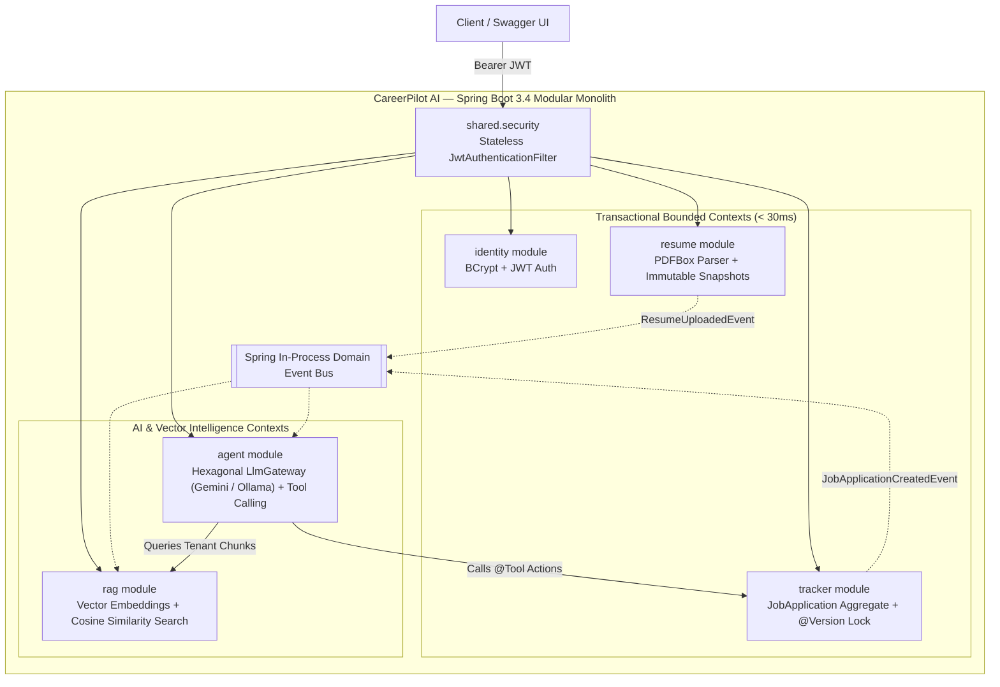

# CareerPilot AI — Event-Driven Modular Monolith for Smart Job Tracking, RAG & AI Coaching


**CareerPilot AI** is an enterprise-grade backend platform built with **Java 21** and **Spring Boot 3.4** that combines transactional job-pipeline management with **Retrieval-Augmented Generation (RAG)** and **Autonomous AI Tool-Calling**.

---

## System Architecture

CareerPilot AI is structured as an **Event-Driven Modular Monolith** with 5 bounded contexts (`identity`, `resume`, `tracker`, `rag`, `agent`) and a cross-cutting `shared` kernel.



---

## Key Engineering Highlights ("Why I Built It This Way")

1. **Decoupling Fast CRUD from Slow AI via Domain Events:**
   * LLM inference and vector embedding take seconds and can experience rate limits. Saving a `Resume` or `JobApplication` commits transactionally and publishes an immutable Java `record` event (`ResumeUploadedEvent`, `JobApplicationCreatedEvent`) so the core HTTP response remains fast while RAG ingestion and AI match scoring execute decoupled from the write path.
2. **DDD Aggregate Root & Optimistic Locking (`@Version`):**
   * `JobApplication` is the Aggregate Root owning `InterviewRound` and the `SalaryRange` value object. Because both the human user and the AI Agent (`CareerTrackerTools`) can mutate application state, `@Version` optimistic locking prevents lost-update race conditions.
3. **Immutable Resume Snapshots & Tenant-Isolated RAG:**
   * Resumes are stored as immutable versions (`Resume v1`, `Resume v2`) parsed from `.pdf` uploads via **Apache PDFBox**, ensuring historical integrity of which resume was submitted to which company. Vector chunks are strictly partitioned by `userId:resumeId` to prevent cross-tenant data leakage.
4. **Hexagonal LLM Gateway (`LlmGateway` Port $\rightarrow$ `ConfigurableLlmAdapter`):**
   * Supports **Google Gemini (`gemini-2.0-flash`)**, **Local Ollama (`llama3.2`)**, and a **deterministic local fallback engine** out of the box so automated CI tests and zero-key local runs work reliably.

---

## Quick Start (Zero-Config Local Run)

### 1. Run the Full Integration Test Suite (4 End-to-End Suites)
```powershell
.\mvnw.cmd test
```

### 2. Start the Application Locally
```powershell
.\mvnw.cmd spring-boot:run
```
* **Swagger UI (Interactive API & Bearer Auth):** `http://localhost:8080/swagger-ui.html`
* **H2 Database Console:** `http://localhost:8080/h2-console` (`JDBC URL: jdbc:h2:mem:careerpilot_local`, User: `sa`)

### 3. Enable Live Google Gemini or Local Ollama (Optional)
```powershell
# Option A: Google Gemini Free Tier
$env:GEMINI_API_KEY="your-gemini-api-key"
.\mvnw.cmd spring-boot:run

# Option B: Local Ollama
$env:AI_PROVIDER="ollama"
.\mvnw.cmd spring-boot:run
```

---

## REST API Reference

| Module | Method & Endpoint | Description |
| :--- | :--- | :--- |
| **Identity** | `POST /api/v1/auth/register` | Register candidate (`BCrypt`) & receive signed JWT |
| **Identity** | `POST /api/v1/auth/login` | Authenticate & receive signed JWT |
| **Identity** | `GET /api/v1/auth/me` | Inspect current JWT principal |
| **Resume** | `POST /api/v1/resumes` | Upload text resume snapshot & trigger RAG chunking |
| **Resume** | `POST /api/v1/resumes/upload-pdf` | Upload `.pdf` file (`MultipartFile`), extract text via PDFBox & embed |
| **RAG** | `GET /api/v1/rag/search` | Semantic vector search over resume chunks ranked by cosine similarity |
| **Tracker** | `POST /api/v1/applications` | Create job application & trigger AI Match Assessment |
| **Tracker** | `GET /api/v1/applications` | List applications (supports `?status=INTERVIEWING` filter) |
| **Tracker** | `POST /api/v1/applications/{id}/interviews` | Schedule interview round on aggregate root |
| **Tracker** | `PATCH /api/v1/applications/{id}/status` | Transition application status (`OFFER`, `REJECTED`, `WITHDRAWN`) |
| **Tracker** | `GET /api/v1/applications/stats` | Pipeline analytics & interview conversion rate |
| **Agent** | `GET /api/v1/agent/assessments/{applicationId}` | Retrieve AI Resume-vs-Job match score & skill gap analysis |
| **Agent** | `POST /api/v1/agent/interview-prep/{applicationId}` | Generate grounded interview prep & optionally auto-schedule round |
| **Agent** | `POST /api/v1/agent/chat` | Chat with AI Coach capable of executing tracker tool calls |
